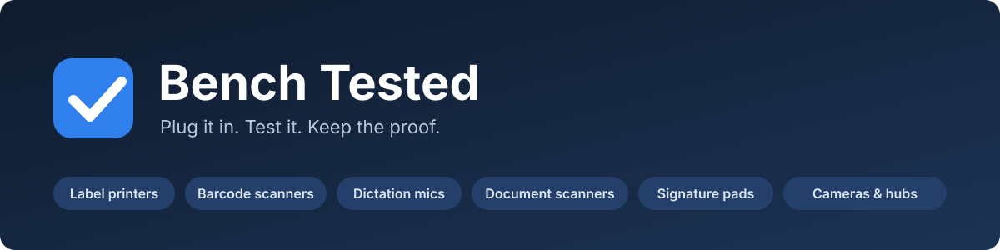
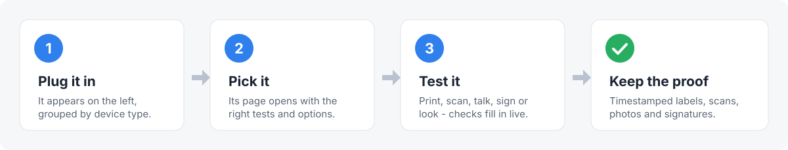

<p align="center">
  
</p>

<p align="center">
  <a href="LICENSE"></a>
  
  
  <a href="CHANGELOG.md"></a>
</p>

**Bench Tested** is a desktop app for Ubuntu that tests used and refurbished office hardware. Plug a device in, click it, run its test. Every test produces **timestamped proof**: a printed label, a saved scan, a photo, a signature image, or a log entry. Use it to back up a "tested and working" listing.

<p align="center">
  
</p>

## Contents

- [What it tests](#what-it-tests)
- [Quick start](#quick-start)
- [A look at the window](#a-look-at-the-window)
- [What a test label looks like](#what-a-test-label-looks-like)
- [Documentation](#documentation)
- [Requirements](#requirements)
- [License](#license)

## What it tests

| Device | What you get | Proof it leaves |
|---|---|---|
| **Zebra label printers** | Factory reset, auto-detected label size and resolution, full-size test label, serial number, head odometer and firmware | Printed test label with date and time |
| **Dymo LabelWriters** | One-click driver setup, labels chosen by Dymo item number (30251, 30256, 30334…) | Printed test label with date and time |
| **Barcode scanners** | Live per-scanner scan view, 1D and 2D test codes with automatic ✓ checks, printable test sheet, factory-reset code library | Scan log with times |
| **Dictation mics** | 3-second record and playback through the mic's own speaker, a check for every button, trackball test | Log with peak level and button results |
| **Document scanners** | Scans the whole feeder stack, flags blank pages and streaks | Every page saved as an image |
| **Topaz signature pads** | Live ink on screen, four-edge check, works with serial (BSB, eSign) and USB HID models | Saved signature image with model and serial number |
| **Cameras & conference hubs** | Live preview, camera controls, pan/tilt/zoom test, speaker → mic check | Saved photo |

Several devices can be tested at the same time. Only the device that's busy is locked.

**Test certificates.** Every unit gets a PDF certificate with its asset tag, make, model, serial number, everything the device reports about itself, each test result and a timestamped activity log, plus a line in a register spreadsheet. See [Test certificates](docs/USER-GUIDE.md#test-certificates).

## Quick start

```bash
git clone https://github.com/ChewyVKB/Bench-Tested.git
cd Bench-Tested
./install.sh
```

Then **log out and back in once**, so the new device permissions take effect. Open **Bench Tested** from the app menu, or run `bench-tested` in a terminal.

Full details are in the [installation guide](docs/INSTALL.md).

## A look at the window

<p align="center">
  
</p>

1. **Toolbar:** clean up stale printer entries, open system printer settings, and refresh the device list.
2. **Connected devices:** everything plugged in, grouped by type. Each row shows a live status line, such as *✓ Done 09:31*.
3. **Device page:** the tests and options for the device you clicked.
4. **Activity log:** a timestamped record of every action on every device.

> The diagram above is an illustration of the layout. Screenshots of the real window can go in [`docs/screenshots/`](docs/screenshots/).

## What a test label looks like

Each test label carries the model, serial number, date and time, a scannable barcode, and a **printhead check band**. The band crosses every dot on the printhead, so a dead dot shows up as a white gap. These previews are rendered from the exact label code the app sends to the printer.

<p align="center">
  
</p>

<p align="center">
  
</p>

## Documentation

| Guide | What's in it |
|---|---|
| [Installation](docs/INSTALL.md) | Installing, updating, uninstalling, and what the installer changes |
| [User guide](docs/USER-GUIDE.md) | Step-by-step testing for every device type |
| [Troubleshooting](docs/TROUBLESHOOTING.md) | Common problems and their fixes |
| [How it works](docs/HOW-IT-WORKS.md) | Technical details for each device type |
| [Changelog](CHANGELOG.md) | Version history |

## Requirements

- Ubuntu 22.04 or newer. Other Debian-based GNOME desktops should work.
- Python 3 with GTK 3. Both come preinstalled on Ubuntu Desktop.
- The installer adds anything else it needs (`zint`, `sane-utils`, GStreamer, PipeWire tools, `v4l-utils`).

## License

[MIT](LICENSE) © 2026 ChewyVKB
