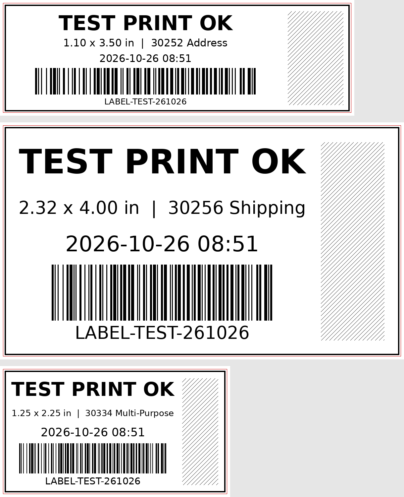

# Bench Tested

A desktop testing bench for Ubuntu. Plug in a device, pick it from the list, and test it. Every test leaves **timestamped proof** that the unit works.

I built it for testing used equipment before reselling it. It's just as handy for checking gear after repairs or setting up a workstation.

**Supported devices right now:**
- **Label printers:** Zebra (ZPL/EPL) and Dymo LabelWriter
- **Barcode scanners:** Symbol/Zebra, Honeywell, Datalogic, Opticon, Newland, and other USB scanners
- **Dictation mics:** Nuance PowerMic, Philips SpeechMike, and similar
- **Document scanners:** Fujitsu fi-series and ScanSnap, plus other scanners Ubuntu's scanner support (SANE) knows
- **Signature pads:** Topaz serial ("BSB") models, such as the T-LBK462-BSB-R
- **Cameras & conference hubs:** USB webcams and conference cameras/speakerphones (Logitech, Poly, Owl and others)

**Coming next:** Topaz USB (HID) pads.



## Features

### Everywhere
- Plugged-in devices appear on their own, grouped by type. Each device has its own page.
- One shared **Activity** log, and a live status line for every device.
- Several devices can work at the same time. Only the device that's busy is locked.

### Label printers
- **Zebra:**
  - **factory reset** (also re-measures the labels)
  - **auto-detects label size and resolution**
  - prints a full-size test label at any size
  - shows the **serial number, head usage (odometer) and firmware**
- **Dymo:**
  - installs the driver the first time it's needed, and sets each model up **once**
  - pick the loaded roll by **Dymo item number** (30251/30252, 30256, 30334…)
- Every test label includes:
  - the date and time
  - a scannable barcode
  - a **printhead check band** that crosses every dot on the printhead, so dead dots show up as gaps without the power draw of a solid black block
- **Print checked** prints on all ticked printers at once. Zebras and Dymos can be mixed, each with its own settings.
- **Clean up printers** removes entries for printers that are no longer connected. Office and network printers are never selected automatically.

### Barcode scanners
- **Live scan view per scanner.** Scans are labeled with the scanner that sent them, so you can test several at once. Scans don't leak into other windows.
- **Test codes** on screen, with automatic ✓ checks:
  - 1D: Code 128, Code 39, UPC-A, EAN-13
  - 2D: QR, Data Matrix, PDF417
- A summary shows whether a scanner reads 1D only or 1D and 2D.
- **Print a test sheet** on a Zebra (as many labels as needed) or on any office printer. Laser scanners can't read screens, so they need the printed sheet.
- Shows how the scanner is connected (USB keyboard, serial/COM port, or HID POS) and warns when it isn't sending scans as typing.
- **Factory reset code library:** add a model's reset barcode once (a screenshot or PDF from its manual), and it shows up automatically for every scanner of that model.

### Dictation mics
- **Record & play back:** talk for 5 seconds and hear the recording through the mic's **own speaker**, which tests the mic and the speaker in one go. A live level meter shows the mic picking you up.
- Recording only ever uses the device being tested, never the computer's built-in mic, so a pass really means this mic works.
- A test tone for the speaker, and the option to play the recording on the computer instead.
- **Press-each-button checklist:** every button that works is ticked off as you press it.
- **Trackball check** on PowerMics: rolls, left click, right click.

### Document scanners
- Scans the whole stack in the feeder (front, back or both sides) and shows each page as it comes in.
- Flags **blank pages** and **dark lines running down the page** (dirty glass or a bad sensor). Include a blank white sheet for the most reliable streak check.
- Every scan is saved as timestamped proof in `~/Pictures/Bench Tested/`. Click a page to open it full size.

### Signature pads
- Draws what you write on the pad live, on screen. That's how you test pads without their own screen; pads with an LCD show the ink on the pad too.
- **Edge check:** run the pen into all four edges to confirm the whole writing area responds.
- **Save signature** stores a timestamped image with the model and serial number as proof. If a model draws upside down, tick **Upside down** once and it's remembered.

### Cameras & conference hubs
- **Live preview** at any resolution the camera supports, with the frame rate shown. **Take photo** saves a timestamped picture as proof.
- **Camera controls:** brightness, focus, white balance and so on, plus a one-click **pan/tilt/zoom test** that moves the camera through its range.
- **Audio section** for devices with a mic or speaker (greyed out for plain webcams):
  - **Speaker → mic check** plays a tone through the device's own speaker and listens for it on its own mic, so both are verified without you saying a word.
  - **Record & play back** works like the dictation mic test.
- The laptop's built-in camera and dock audio are ignored.

## Requirements

- Ubuntu 22.04 or newer (other Debian-based GNOME desktops should work)
- Python 3 with GTK 3 (`python3-gi`, `gir1.2-gtk-3.0`), preinstalled on Ubuntu Desktop
- CUPS (preinstalled), used for Dymo printers
- Installed by the installer if missing:
  - `zint` draws the barcode test codes
  - `sane-utils` runs document scanners
  - GStreamer and PipeWire tools handle mic recording, playback and the camera preview
  - `v4l-utils` reads camera modes and controls

## Install

```bash
git clone https://github.com/<you>/<repo>.git
cd <repo>
./install.sh
```

The installer:
- copies the app to `~/.local/share/bench-tested`
- adds **Bench Tested** to your app menu, plus a `bench-tested` command
- installs anything missing
- gives your user access to USB devices (see the next section)

**Log out and back in once** after the first install.

To uninstall: `./uninstall.sh`

### About device access

The installer adds you to three groups. You can skip any of them; the related feature just works more simply.

| Group | Why | Without it |
|---|---|---|
| `lp` | Talk to Zebra printers over USB | Zebra printing doesn't work |
| `input` | See which scanner sent each scan, and read dictation-mic buttons | Scans still work (click the box on the scanner page and scan), but mic buttons can't be tested |
| `dialout` | Read serial-mode scanners and signature pads | Those devices can't be read |

Being in `input` lets programs you run read keyboards and other input devices. That's normal for a dedicated test bench. Skip it on a shared computer if that's a concern.

## Usage

1. Plug in a device. It shows up on the left. If it doesn't, click **Refresh devices**.
2. Click it to open its page.
3. Run its test:
   - **Printers:** click **Print test label**, or tick several printers and click **Print checked**.
   - **Scanners:** scan the test codes on screen or on a printed sheet, and watch the ✓ marks fill in.

## Troubleshooting

| Problem | Fix |
|---|---|
| Zebra shows "not available as /dev/usb/lp*" | Unplug it and plug it back in. If that doesn't help, run `sudo modprobe usblp` |
| "No permission to use /dev/usb/lp…" | Run `sudo usermod -aG lp $USER`, then log out and back in |
| Zebra faults (red light) partway through a label | Usually a weak or non-original power supply |
| Dymo says "sent" but nothing prints | Click **Set up again**, then **Clear print queue**, and check that labels are loaded |
| Dymo LabelWriter 550 series | Poor Linux support. These only print on genuine RFID-chipped Dymo rolls. |
| Scanner listed, but scans don't appear | It may be in HID POS/OPOS mode. Scan its **factory reset** or "USB keyboard" code. |
| Laser scanner won't read the screen | Normal. Use **Print test sheet…** |
| Mic buttons don't register | Log out and back in once after installing, so the `input` group takes effect |
| Mic recording fails | The Activity log shows which sound device was found. Unplug and replug the mic, then try again. |
| Camera listed but no picture | Try another resolution in the drop-down, or unplug and replug it. Some conference cameras (e.g. Meeting Owl) need first-time setup in their own app. |
| Speaker → mic check fails | Check the device isn't muted and its volume is up, then try again |
| Document scanner says it isn't found | Make sure it's switched on, then click **Look for scanner again**. Check that `scanimage -L` lists it. |

## How it works

- **Zebra:** ZPL/EPL sent straight to `/dev/usb/lp*`.
  - Factory reset: `^JUF` then `^JUS`
  - Calibration: `~JC`
  - Label size and info: read from the printer's `^HH` configuration reply
- **Dymo:** a PostScript page at the exact label size, printed through CUPS with the official Dymo driver.
- **Scanners:**
  - keyboard-mode scanners are read from `/dev/input` and kept from typing into other windows while Bench Tested runs
  - serial-mode scanners are read from `/dev/ttyACM*`
- **Dictation mics:** the mic's own sound card is found through sysfs and PipeWire, then recorded and played with GStreamer (or `arecord`/`aplay`). Buttons and trackball are read from `/dev/input`.
- **Cameras:** GStreamer (`v4l2src`) preview, `v4l2-ctl` for modes and controls. The speaker → mic check detects the test tone with a Goertzel filter.
- **Signature pads:** Topaz BSB pads are read straight from their serial port (19200 baud, 7 data bits, odd parity, 5-byte pen packets).
- **Document scanners:** `scanimage` (SANE) in batch mode. Pages are analyzed for blank pages and vertical streaks.
- **Settings:** stored in `~/.config/bench-tested.json`. Reset codes are stored in `~/.local/share/bench-tested/reset-codes/`.

Pure Python + GTK, with no dependencies beyond what Ubuntu ships (plus `zint` for 2D codes).

## License

MIT. See [LICENSE](LICENSE).
