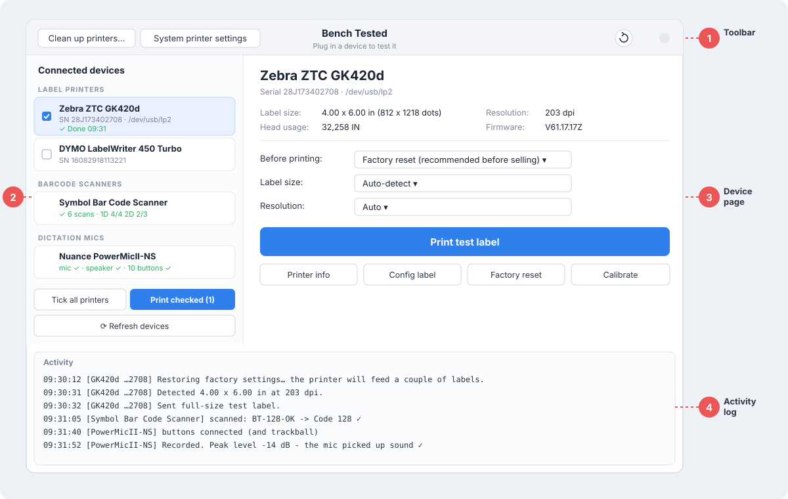
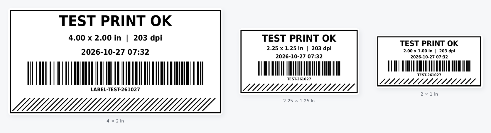
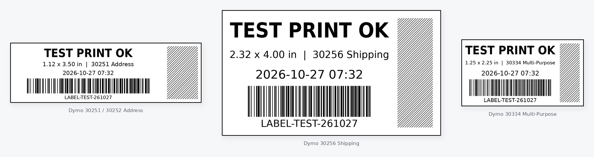

# User guide

[← Back to README](../README.md)

Step-by-step instructions for testing every type of device Bench Tested supports.

## Contents

- [The basics](#the-basics)
- [Zebra label printers](#zebra-label-printers)
- [Dymo LabelWriters](#dymo-labelwriters)
- [Printing on several printers at once](#printing-on-several-printers-at-once)
- [Barcode scanners](#barcode-scanners)
- [Dictation mics](#dictation-mics)
- [Document scanners](#document-scanners)
- [Topaz signature pads](#topaz-signature-pads)
- [Cameras and conference hubs](#cameras-and-conference-hubs)
- [Where your proof is saved](#where-your-proof-is-saved)
- [A suggested routine for resale testing](#a-suggested-routine-for-resale-testing)

---

## The basics

1. **Plug the device in.** Within a second or two it appears in the list on the left, under its device type. If it doesn't, click **Refresh devices**.
2. **Click it** to open its page.
3. **Run its test.** Each page tells you what to do, and ✓ marks fill in as each check passes.
4. **Read the result.** The row on the left shows a short status, and the **Activity** log at the bottom keeps a timestamped line for everything that happened.

Good to know:
- You can test **several devices at once.** While one device is busy, only its own page is locked.
- **Swapping units is fine.** Unplug one and plug in the next. Each fresh plug-in is treated as a new unit with a clean result, even when it's the same model in the same port.
- Settings you choose (label size, the roll loaded, *Upside down* and so on) are remembered **per unit** by serial number. Where it makes sense, a new unit starts with the last settings used on that model.

---

## Zebra label printers

Works with ZPL and EPL Zebras such as the GK420d, GX420d, ZD410, ZD420, ZD620, LP 2844 and TLP 2844.

**Steps**

1. Load labels, turn the printer on and plug it in by USB.
2. Click it in the list. The page shows its **serial number, label size, resolution, head usage (odometer) and firmware**.
3. Choose what happens **Before printing:**
   - **Factory reset (recommended before selling).** This clears the previous owner's settings and re-measures the labels. The printer feeds a couple of labels.
   - **Full calibration.** Re-measures the labels without resetting anything else.
   - **Nothing.** Uses the current settings.
4. Leave **Label size** and **Resolution** on **Auto-detect** / **Auto**. Bench Tested asks the printer what's loaded.
5. Click **Print test label**.

**What to check on the label**

- The text and barcode are sharp and the label is fully printed edge to edge.
- The **printhead check band** has no thin white lines running through it. A white line means a dead dot on the printhead.
- Scan the barcode to confirm it reads.

**Other buttons**

| Button | What it does |
|---|---|
| **Printer info** | Reads the serial number, head usage, firmware and settings again |
| **Config label** | Prints the printer's own built-in configuration label |
| **Factory reset** | Resets to factory settings only, without a test label |
| **Calibrate** | Runs a full media calibration only |

**Printer language:** most Zebras use ZPL. Choose **EPL** for the LP 2844, TLP 2844 and other older models.

---

## Dymo LabelWriters

Works with LabelWriter 400, 450, 450 Turbo, 450 Twin Turbo, 4XL and similar models.

**Steps**

1. Load a roll and plug the printer in.
2. Click it in the list. **The first time you use a model**, Bench Tested sets it up and installs the Dymo driver if needed. Enter your password when asked; this can take a minute. Each model is set up only once.
3. Pick the roll that's loaded under **Labels loaded**. Dymos can't sense their labels, so this has to be set by hand. Rolls are listed by Dymo item number:

   | Item number | Label |
   |---|---|
   | 30251 / 30252 / 30320 | Address |
   | 30321 | Large Address |
   | 30256 | Shipping |
   | 30323 | Shipping |
   | 30334 | Multi-Purpose |
   | 30336 | Small Multi-Purpose |
   | 30330 | Return Address |
   | 30332 | Square |
   | 1744907 | 4 × 6 Shipping (4XL only) |

4. Click **Print test label** and check the label just as for a Zebra.

**If a Dymo misbehaves**

| Button | When to use it |
|---|---|
| **Set up again** | It printed nothing or printed garbage. This reinstalls the model with the correct driver. |
| **Clear print queue** | Jobs are stuck. This cancels them and re-enables the printer. |

> **LabelWriter 550 series:** these only print on genuine, chipped Dymo rolls and have poor Linux support.

---

## Printing on several printers at once

1. Tick the box next to each printer in the list, or click **Tick all printers**.
2. Click **Print checked**.

Every ticked printer prints its test label at the same time, each with its own settings. You can mix Zebras and Dymos.

**Clean up printers…** in the toolbar removes system printer entries left behind by USB printers that are no longer plugged in. Office and network printers are never ticked for removal automatically.

---

## Barcode scanners

Works with USB scanners from Symbol/Zebra, Honeywell, Datalogic, Opticon, Newland and most others, in keyboard (HID), serial (COM port) or HID POS mode.

**Steps**

1. Plug the scanner in and click it in the list. The page shows how it's connected. If it isn't sending scans as typing, a warning tells you so.
2. Scan the **test codes** on the screen. Each code gets a ✓ as soon as it's read:
   - **1D:** Code 128, Code 39, UPC-A, EAN-13
   - **2D:** QR Code, Data Matrix, PDF417
3. The summary tells you whether the scanner reads **1D only** or **1D and 2D**. That's handy for the listing.

Every scan appears under **Scans from this scanner**, labelled with the scanner that sent it. That means you can test several scanners at once.

Scanners are only held while Bench Tested is the active window. **Switch to another window, such as your browser, and every scanner types there as normal.** Bench Tested ignores those scans, so you can keep it open all day next to other work.

**Laser scanners** can't read screens. Click **Print test sheet…** and print the codes:
- on a **Zebra**, spread over as many labels as needed, or
- on any **office printer** on a full sheet of paper.

**Factory reset codes**

Most scanners can be reset by scanning a special barcode from their manual. Bench Tested keeps a library of them.

1. On a scanner's page, click **Factory reset code…**
2. If none is saved for that model yet, click **Add reset code…** and pick a screenshot or PDF of the reset barcode from the manual. **Find the manual online** helps you locate it.
3. From then on, the code is shown for every scanner of that model. Scan it straight off the screen, or open the PDF page.

> If a scanner is listed but its scans never appear, it's probably in HID POS / OPOS mode. Scan its factory-reset or "USB keyboard" code.

---

## Dictation mics

Works with Nuance PowerMic II / III / 4, Philips SpeechMike and similar dictation mics.

The page has three sections.

**1. Microphone and speaker**

1. Click **Record & play back (3 s)** and talk into the mic for 3 seconds. The level meter moves while you talk.
2. The recording plays back through **the mic's own speaker**, so one test checks both. Did you hear yourself?
3. Optional: **Test tone on mic speaker** checks the speaker on its own. **Play recording on computer** plays it through the computer instead.

Recording only uses the mic being tested, never the computer's built-in mic, so a ✓ really means this mic works. If it recorded only silence, you'll see **Microphone ✗**.

**2. Buttons**

Press every button on the mic once. Each working button is added to the list as you press it, including buttons that do nothing on Linux. Compare the list with the buttons on the mic.

**3. Trackball** (PowerMics)

Roll the trackball in every direction and click both trackball buttons.

**Testing the next mic:** just unplug and plug in the next one. **Start this mic's test over** clears the results for the current unit.

---

## Document scanners

Works with Fujitsu fi-series and ScanSnap, and other scanners that Ubuntu's scanner support (SANE) recognizes.

**Steps**

1. Turn the scanner on and plug it in. Click it in the list.
2. Load a few pages in the feeder. **Include one blank white sheet.** It's what the streak check looks at.
3. Choose **Sides / feeder** (front, back or both sides), **Color** and **Resolution**.
4. Click **Scan the feeder**. Pages appear one by one as they come in. **Stop** ends the scan early.

**What's checked automatically**

- **Blank pages** are flagged. On a two-sided scan this confirms that both sides of the scanner capture.
- **Dark lines running top to bottom** are flagged, with their position across the page. They mean dirty glass or a bad sensor.

Click any page to open it full size. **Open scans folder** shows the saved files.

If the scanner isn't found, check that it's switched on, then click **Look for scanner again**.

---

## Topaz signature pads

Works with Topaz serial pads, both **BSB** models (for example the T-LBK462-BSB-R) and **eSign** models on a USB-B printer-style cable, and with Topaz **USB HID** pads (listed as *Topaz HID Tablet*).

**Steps**

1. Plug the pad in and click it in the list. Bench Tested finds the right connection settings for that model on its own. For a model it hasn't seen before, it tries the common settings until the pen data reads cleanly, then remembers the one that worked.
2. Sign on the pad. The ink appears on screen as you write. Pads with an LCD show it on the pad too. Hovering the pen just above the pad shows a dot that follows the pen.
3. **Edge check:** run the pen off all four edges of the writing area. The status line counts the edges reached: *✓ pen works · edges reached 4/4*.
4. Click **Save signature** to keep a timestamped image with the model and serial number on it.

Like the pad's own screen, the drawing clears itself **4 seconds after you stop writing**. The ✓ checks stay. **Save signature** still saves the last signature after it has cleared.

| Button | What it does |
|---|---|
| **Clear** | Wipes the drawing to try again |
| **Upside down** | Tick it if a model draws upside down. It's remembered for that model. |

---

## Cameras and conference hubs

Works with USB webcams and conference cameras and speakerphones from Logitech, Poly, Owl Labs and others. The laptop's own built-in camera and dock audio are ignored.

**Speakerphones and expansion mics** without a camera (Logitech, Poly/Polycom, Jabra, EPOS) are listed here too. Their page shows only the audio tests.

**Camera**

1. Plug the camera in and click it in the list. A live preview starts.
2. Pick a **resolution / frame rate** from the drop-down to try the camera's modes. Each mode lists its frame rate.
3. Click **Take photo** to save a timestamped picture.

**Camera controls**

Adjust brightness, focus, white balance and anything else the camera offers. **Test pan / tilt / zoom** moves a PTZ camera through its range automatically. **Reset controls to default** puts everything back.

**Audio** (only for devices with a mic or speaker; greyed out for plain webcams)

- **Speaker → mic check** plays a tone through the device's own speaker and listens for it on its own mic. You'll see *Speaker → mic ✓* when the mic hears the tone. Nobody has to say a word.
- **Record & play back (3 s)** works just like the dictation mic test.

---

## Where your proof is saved

| Proof | Where |
|---|---|
| Test labels | Printed, with the date and time on each label |
| Document scans | `~/Pictures/Bench Tested/` |
| Signatures | `~/Pictures/Bench Tested/` |
| Camera photos | `~/Pictures/Bench Tested/` |
| Everything else | The **Activity** log (timestamped, in the app window) |

Each file or folder name includes the device and the date and time. Signatures are saved as SVG images, which open in any web browser. Photos of the unit plus these files make a complete record for a listing.

---

## A suggested routine for resale testing

1. Plug in the unit and note the **serial number** shown on its page.
2. For printers, use **Factory reset** before printing, so the buyer gets clean settings.
3. Run the test and wait until every check shows ✓.
4. Photograph the unit next to its proof: the printed label, or the screen showing the result.
5. For scanners, note **1D only** or **1D and 2D** in the listing.
6. Unplug it and move on to the next one.
